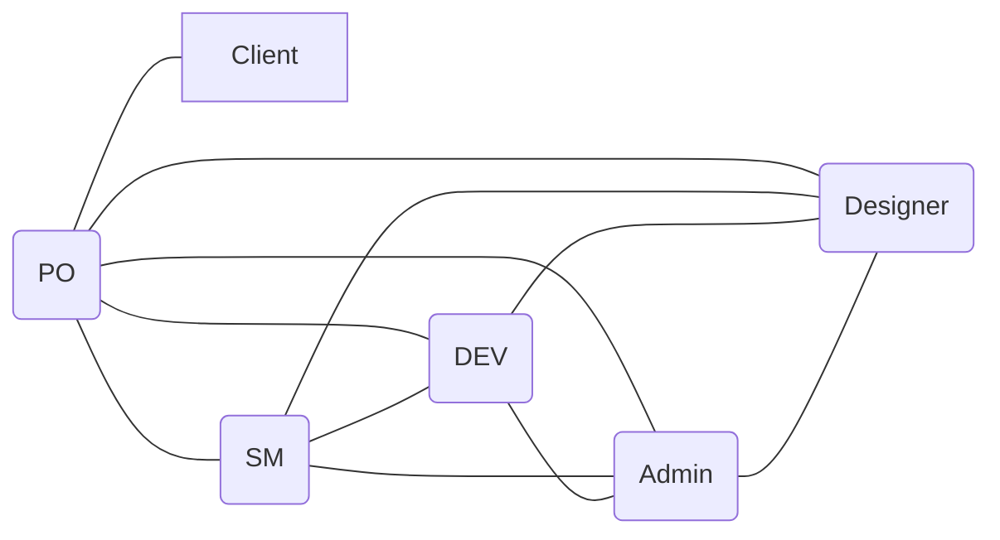

# Communication overhead · <CouterBlock> (v1.0, 2026-__-__)
Brook's Rule: Path = n(n-1)/2
## Paths
|           Model           |    People (n)   | Calculation | Paths | Minutes/week | Hours/week | Overhead % | 
|---------------------------|-----------------|-------------|-------|--------------|------------|------------|
| (a) Everyone to client    |        6        |  6(6-1)/2   |   15  |    300mins   |   5.00hrs  |   33.3%    |
| (b) only PO to client     | 5 devs+1 client |  5(5-1)/2+1 |   11  |    220mins   |   3.67hrs  |    24.4%   |

. Assumption: Each communication path requires ~20 minutes per week, because of constantly reviewing,syncing with the client's requirement.
. Saving: Model (b) saves 4 paths, or about 0.67 h per week (roughly 27 % of the model (a) overhead). Even in model (b), about one hour in every eight of our lab time goes to talking about the work rather than doing it.

## Our paths (model b)


## Two practices
1. **20-minute stand-up, three times a week (Mon, Wed, Fri).** The Scrum Master (Mengcheu) runs it. Everyone answers: what I finished, what I do next, what blocks me. One shared meeting replaces most one-to-one "what are you working on?" chats, so the 10 member-to-member paths shrink to short ad-hoc conversations.
   - Stand-ups: 3 × 20 min = 60 min
   - Residual member-to-member paths: 20 × 5 min = 100 min
   - PO-to-client (unchanged): 1 × 20 min = 20 min
   - Total 300 min -> **new overhead: 5.00 h/week (33.3%)**
2. **GitHub Issues as the single source of truth.** The PO (Meynanon) turns every client request into an Issue with one assignee, a label and a status on the project board. The Designer (Makhen) attaches mockups to the Issue, and the Developer (MonyOudom) links commits and pull requests to it. Questions like "who owns this?" and "is it done?" are answered by reading the board, and decisions are written in the Issue thread, not in private chats. Cost per member-to-member path drops from 20 min to 10 min.
   - Member-to-member: 10 × 20 min = 200 min
   - PO-to-client (unchanged): 1 × 20 min = 20 min
   - Total 220 min -> **new overhead: 3.67 h/week (24.4 %)**

## A sixth member in week 11?
Model (b) with n = 6 members:

```
paths(b) = 6 × 5 / 2 + 1 = 15 + 1 = 16
```

- Paths rise from 11 to 16: **+5 paths (+45 %)**.
- Cost rises from 220 min to 320 min: **3.67 h to 5.33 h per week**.
- Capacity rises from 15 h to 18 h (6 × 3), so overhead goes from 24.4 % to **29.6 %** (5.33 ÷ 18), before counting onboarding time.

**Decision:** We would decline the offer, because in week 11 the five new paths plus onboarding would cost the team more than a newcomer could add before the deadline (Brooks's law: adding people to a late project makes it later).

## Reflection: the essential difficulty we expect first
- The difficulty we expect to hit first is changeability. ITC Club Hub serves clubs whose needs shift every semester, and our understanding of those needs will shift as soon as real officers and members see a prototype. In the brief, [example: the requirement that clubs can post events and manage memberships] sounds fixed, but the details are the kind stakeholders revise once they see a working screen. Who approves an event? Can a student belong to several clubs? What counts as an “active” club? Because software looks easy to change, people keep asking for changes, and each one ripples through code we have already written.

Over the next four weeks we will do three things. First, in week one we list the requirements most likely to change and isolate them in separate modules or configuration, so a rule change touches one place. Second, we demo to a club officer at the end of weeks two and four and record every requested change in a shared log marked accept, defer, or reject. Third, we use small, frequent commits and reviewed pull requests, so every change stays traceable and reversible.

## Agreed and Signed by:

- Member 1 Sin Meynanon, 2026-10-21
- Member 2 Ath Mengcheu, 2026-10-21
- Member 3 Soth Monyoudom, 2026-10-21
- Member 4 Sin Ngoun Taymeng, 2026-10-21
- Member 5 Tra Makhen, 2026-10-21