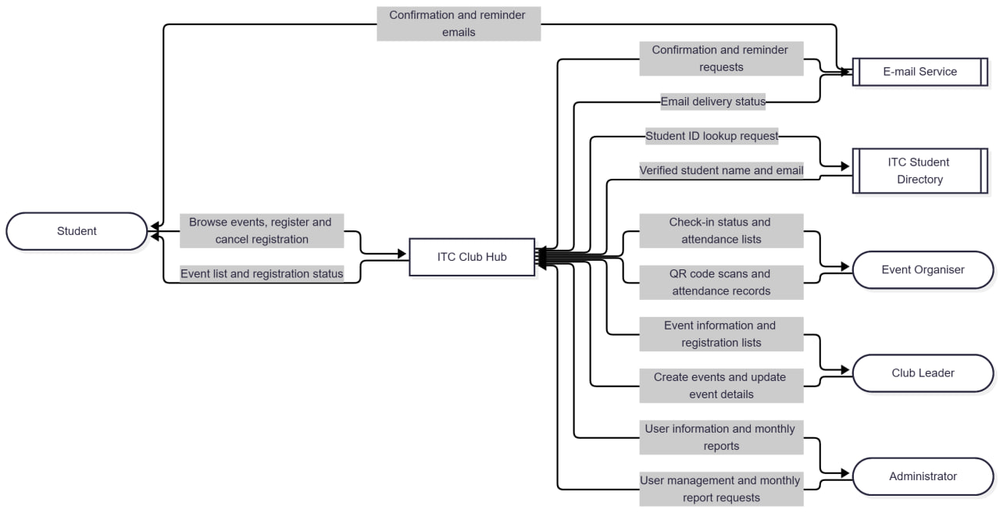
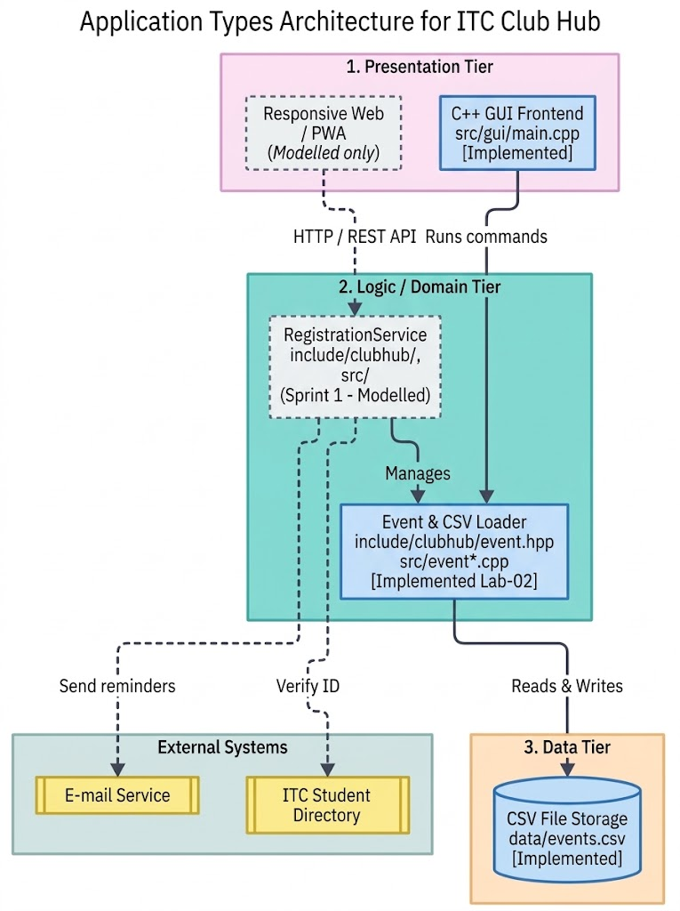

# Lab-02. Types of Applications & Architecture (v1.0, 2026-10-28)

# Files of this Lab
| File | Task | Author(s) |
| :--- | :---: | :--- |
| `lab02/offline-checkin.md`, `lab02/challenge/README.md` | Task 1 | Srum Master |
| `lab02/app-classification.md`, `lab02/app-quadrant.md` | Task 2 | Admin |
| `lab02/quality-scenarios.md`, `lab02/context-diagram` | Task 3 | Developer |
| `lab02/adr-001-application.md`, `lab02/architectures.md` | Task 4 | Designer | 
| `src/cli/main.cpp`, `CMakeLists.txt`, `data/events.csv` | Task 5 | Product Owner |
| `include/clubhub/event*.hpp`, `src/event*.cpp` | Task 5 | Product Owner | 

# Inputs Reused from Lab-01
* Problem statement & Stakeholder list from `lab01/team-charter.md`
* Decision rules from `lab01/decision.md`

# Architecture Diagram 

# Channel Log
| Date | Version | What changed | By |
|------|---------|--------------|----|
| 2026-11-03 | 1.0 | First version of the Lab-02 README. Added the offline check-in design, the context diagram, the queued check-in header, the event core and the list-events GUI. | TODO |
