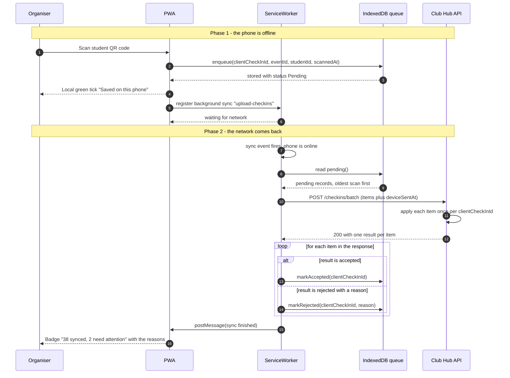

# Challenge: Offline-First Check-In for ITC Club Hub
Version 1.0 2026-11-02 Team: BinaryOne

---

## 1. Sequence Diagram: Offline Scan & Reconciliation 
This diagram illustrates an organizer scanning a QR code while disconnected, saving it locally, reconnecting to Wi-Fi and batch-syncing to the server.

## 2.Conflict Resolution Rule
| # | Case | Winner | What Organizer sees | What is stored on the server |
| :-: | :--- | :--- | :--- | :---|
| **1** | 