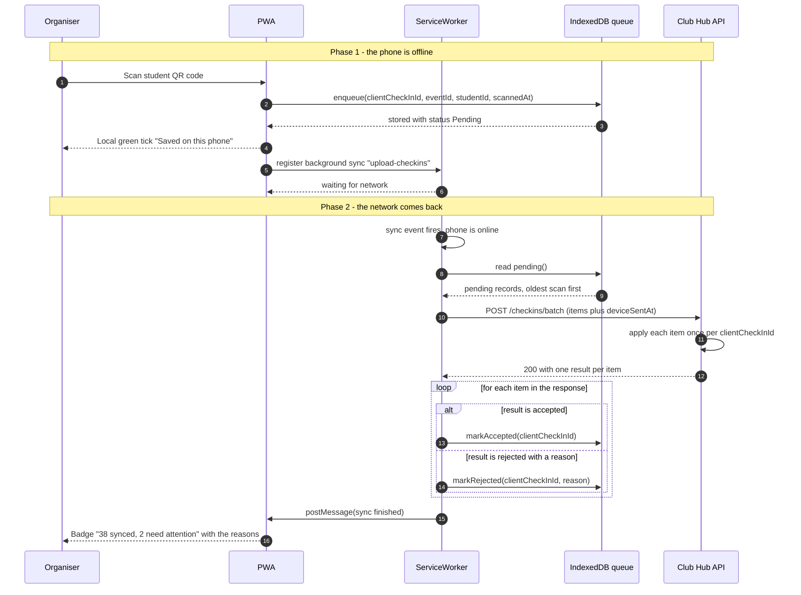

# Challenge: Offline-First Check-In for ITC Club Hub
Version 1.0 2026-11-02 Team: BinaryOne

---

## 1. Sequence Diagram: Offline Scan & Reconciliation 
This diagram illustrates an organizer scanning a QR code while disconnected, saving it locally, reconnecting to Wi-Fi and batch-syncing to the server.


The server always answers the whole batch with HTTP 200 and decides per item, so one bad record never blocks the others:

```json
{
  "results": [
    { "clientCheckInId": "7c1e…", "status": "accepted" },
    { "clientCheckInId": "a93f…", "status": "accepted", "replayed": true },
    { "clientCheckInId": "d02b…", "status": "rejected", "reason": "REGISTRATION_CANCELLED" },
    { "clientCheckInId": "5e44…", "status": "rejected", "reason": "NOT_REGISTERED" }
  ]
}
```

## 2.Conflict Resolution Rule

General rules behind the table:

- The server is the source of truth for registrations. The phone only holds a cached roster.
- A student has at most one attendance row per event (unique on `eventId + studentId`).
- Ordering between scans uses the corrected scan time: raw `scannedAt` plus the clock offset the server works out for that phone.
- A rejected scan is never deleted. It stays in an audit log with its reason.

| # | Case | Winner | What Organizer sees | What is stored on the server |
| :-: | :--- | :--- | :--- | :---|
| **1** | Same student scanned at both doors (two phones) | The scan with the earlier corrected time. The later one is rejected as `DUPLICATE_CHECK_IN`. | Green tick at the door, later a grey note "already checked in at 18:02, Door A". No alarm, the student is in. | One attendance row (the earlier scan). The later scan goes to the audit log as rejected. |
| **2** | Scan for a registration that was cancelled on the server in the meantime | The server. If the cancellation time is at or before the corrected scan time, the scan is rejected as `REGISTRATION_CANCELLED`. If the cancellation came after the scan, the scan is accepted because the student was already there. | Green tick at the door. After sync a red item "Registration cancelled at 17:40" in the "need attention" list, so the organiser can decide with the student. | Rejected case: no attendance row, scan kept in the audit log with the cancellation time. Accepted case: normal attendance row. |
| **3** | Student not registered at all | The server. Scan rejected as `NOT_REGISTERED`. | If the student is missing from the cached roster, an amber tick "Not on the list, saved for checking" instead of green. After sync the item appears in "need attention" with an option to register them as a walk-in while online. | No attendance row. Scan kept in the audit log as rejected. |
| **4** | Retry of an upload the server already applied (response was lost) | Nobody loses: the server recognises the `clientCheckInId`, does not apply it again and returns the original outcome with `replayed: true`. | Nothing new. The item turns to "synced" once and the counter does not go up twice. | Still one row. The stored outcome for that `clientCheckInId` is returned unchanged. |
| **5** | Phone clock is 7 minutes wrong | Ordering uses the server's corrected time, not the phone's. The server works out `offset = receivedAt - deviceSentAt` for the batch and applies it to every item. The scan is still accepted if the corrected time is inside the event window. | A small amber banner on the phone "Your clock looks about 7 minutes off". Scans are not blocked. | Raw `scannedAt`, `clockOffset`, corrected scan time and `receivedAt` are all stored, so the correction can be audited. |
