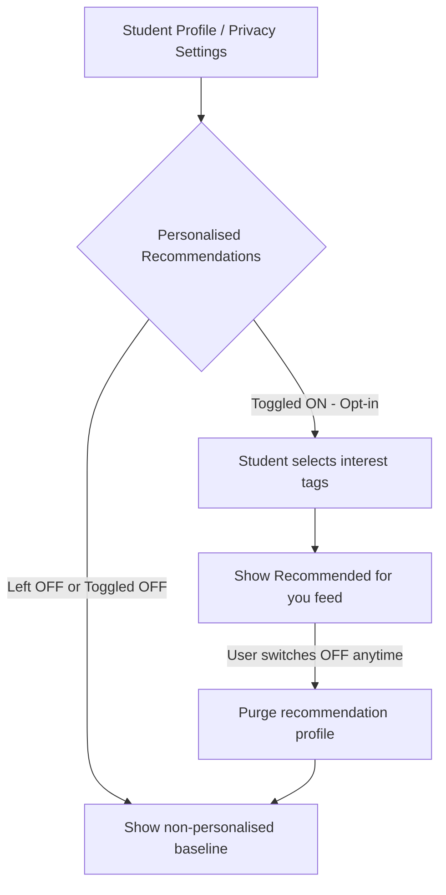
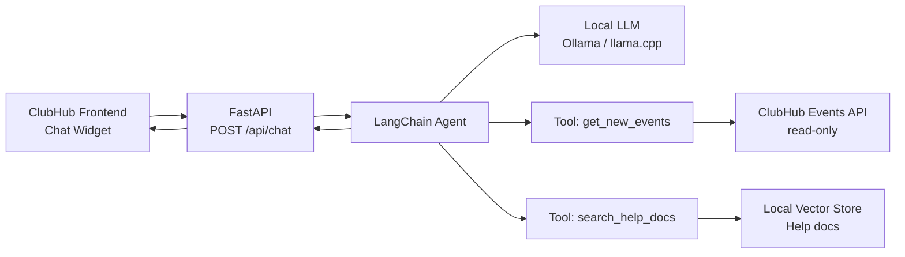
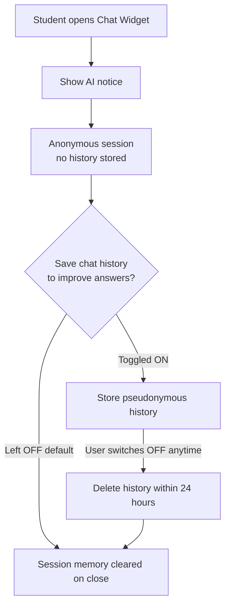

# ClubHub AI Feature Proposals

Version 1.0 · 2026-11-11 · Authors: Team I2-ISE

This document covers two AI features we plan to implement together:

| | Feature | Purpose | Opt-in model |
|---|---|---|---|
| **Part A** | "Recommended for You" Event Recommender | Suggest relevant events to each student | Strict opt-in (personalisation) |
| **Part B** | "ClubHub Assistant" Chatbot | Check new events and answer "how do I use ClubHub?" | Optional to use; chat history is a separate opt-in |

Part C lists the principles and conditions that apply to both features.

---

# Part A: "Recommended for You" Event Recommender

## A1. Problem and Non-Personalised Baseline

### The User Problem
Students currently have to browse through dozens of weekly club events across multiple departments. Many relevant workshops and seminars are missed simply because students do not know they exist.

### Non-Personalised Baseline (Before adding AI)
Before implementing complex AI, the system should offer simple, privacy-safe, non-personalised heuristics:
- **"Popular on Campus":** Top 5 events with the highest current registrations.
- **"Happening Soon":** Events taking place within the next 48 hours.
- **"Browse by Category":** Filter by tags (e.g., Tech, Sports, Arts, Culture).

*Only if this baseline proves insufficient should personalised machine learning be considered.*

---

## A2. Data Needed

To train and run a personalised recommender, the following data would be processed:

| Field | Source | In Task 1 Inventory? | New Purpose / Consent? | Minimisation Rule |
|---|---|:---:|---|---|
| `event_category_history` | Past check-ins | Yes (attendance) | **Yes:** Profiling student interests requires separate explicit consent. | Only store high-level categories (e.g. "Robotics: 3", "Music: 1"); do not track time of day or who they attended with. |
| `department_faculty` | ITC Directory | No (dropped) | **Yes:** Needed to recommend faculty-specific seminars. | Coarse department level only (e.g., "GIC", "GCA"); no grades, GPA, or year of study. |
| `event_tags` | Event details | Yes | No (public event metadata). | Open event tags; no personal data involved. |
| `student_name` / `email` | Profile | Yes | **No (Not needed):** The ML model only needs an anonymous token ID. | **Dropped from ML pipeline:** Strip all names, emails, and phone numbers before feeding to recommender. |

---

## A3. Bias Risks and Fairness Checks

| Bias Risk | Who Is Harmed | Mitigation Strategy | Fairness Check (Metric & Threshold) |
|---|---|---|---|
| **Popularity Bias / Filter Bubble** | Small clubs (e.g., Chess, Debate) get zero visibility; mega-clubs dominate. | Introduce 20% random exploration ("serendipity injection") from small clubs with <30 members. | **Catalog Coverage:** At least 85% of active clubs must appear in recommendations weekly across the student body. |
| **Department Stereotyping** | Female students or non-tech majors never get recommended engineering/coding hackathons. | Do not use gender or demographic features; base recommendations strictly on voluntary tag selections. | **Demographic Parity:** Recommendation rates for technical events must not deviate by more than 10% across genders or faculties. |
| **Cold-Start Penalty** | Year 1 students with zero history get blank or irrelevant suggestions. | Fall back immediately to the non-personalised baseline ("Popular on Campus") until 3 events are attended. | **Cold-Start Click-Through Rate (CTR):** New student engagement must be within 15% of active user engagement. |
| **Academic Tracking Risk** | Disciplinary or low-attendance students get targeted with remedial events only. | Strictly air-gap Club Hub recommendations from university academic marks or disciplinary records. | **Zero-correlation Audit:** Recommendation scores must have zero mathematical correlation with student GPA. |

---

## A4. Transparency: "Why am I seeing this?"

Every recommended event card in the UI displays an info icon `(ℹ️)`. Clicking it reveals a plain-English explanation:

> **Example:**
> **Event:** *Introduction to Autonomous Drones Workshop*
> **Why you are seeing this:**
> *"You attended the 'Robotics Club Showcase' last month, and you selected 'Technology & Engineering' in your interest preferences. We do not use your grades, age, or friends' activity to pick this event."*

---

## A5. Opt-Out / Opt-In Design

Because personalised recommendations involve algorithmic profiling under GDPR principles, this feature operates on **strict opt-in**:

---

## A6. Final Recommendation: Recommender

### GO WITH CONDITIONS
We recommend proceeding with the development of the AI Event Recommender only if the following four strict conditions are satisfied:

1. **Strict Opt-In by Default:** The recommendation engine remains inactive until a student explicitly turns it on in their settings. No pre-checked boxes or forced activation during account signup.
2. **Pseudonymised Model Inputs:** The recommender pipeline only consumes salted hashes (`hash(studentId)`) and high-level interest tags. Real names, email addresses, phone numbers, and academic records must never enter the model.
3. **Guaranteed Fallback Quality:** Students who opt out must never receive a degraded user experience; they will be provided with the high-quality curated baseline ("Popular on Campus").
4. **Permanent Purge Guarantee:** When a student disables the feature, their behavioral profile, interest scores, and recommendation cache must be completely wiped from active storage within 24 hours.

### Owner of Fairness Audits
The **Scrum Master** and **Product Owner** will conduct a bi-weekly fairness review before each sprint review to evaluate recommendation logs against the Catalog Coverage (≥ 85%) and Demographic Parity thresholds.

---

# Part B: "ClubHub Assistant" Chatbot

## B1. Problem and Non-Personalised Baseline

### The User Problem
Students miss newly posted events because they only check ClubHub occasionally. New users also struggle to find features such as registering, cancelling, or changing privacy settings, and end up asking club admins the same questions repeatedly.

### Non-Personalised Baseline (Before adding AI)
- **"New This Week":** A list of events posted in the last 7 days.
- **Help Centre / FAQ page:** A static page with "How do I register?", "How do I cancel?" and "How do I turn off recommendations?"
- **Search bar:** Keyword search across event titles and tags.
- **Onboarding tooltips:** A short first-login tour of the main features.

*Only if this baseline proves insufficient should a chatbot be built.*

---

## B2. Scope and Technical Design

### What the chatbot can do
| Capability | Description | Type |
|---|---|---|
| **Check new events** | "What's new this week?" or "Any tech workshops tomorrow?" | Read-only tool call to the Events API |
| **How-to help** | "How do I cancel my registration?" | Retrieval from official ClubHub help docs |
| **Out of scope** | Registering, cancelling, or changing settings on the student's behalf | **Not allowed in v1** (read-only) |

### Architecture
- **Local LLM:** A small open-weight model served locally (e.g. via Ollama or llama.cpp), so no student data leaves campus servers.
- **LangChain as the agent framework:** It routes each question to the right tool.
- **Tools:**
  - `get_new_events(days, category)` calls the existing ClubHub REST API (read-only, public event fields only).
  - `search_help_docs(query)` runs retrieval (RAG) over ClubHub's help documentation in a local vector store (e.g. Chroma or FAISS).
- **Exposed through an API:** A FastAPI service (`POST /api/chat`) that the ClubHub frontend calls.

> **Note on "training":** For v1 we recommend **RAG, not fine-tuning**. The help docs are small and change often, and RAG lets us update answers by editing documents instead of retraining. Fine-tuning can be revisited later for tone or Khmer language support.

## B3. Data Needed

| Field | Source | In Task 1 Inventory? | New Purpose / Consent? | Minimisation Rule |
|---|---|:---:|---|---|
| `event_title / date / category / location` | Events API | Yes | No (public event metadata). | Public fields only; no attendee lists or registration counts per person. |
| `help_docs` | ClubHub documentation | N/A | No. | Only official, reviewed documents are indexed. |
| `chat_message` (current session) | Student input | No | **Yes:** Processed only to answer the question. | Session-only memory; warn students not to type personal data. |
| `chat_history` (stored) | Chat logs | No | **Yes:** Optional, separate opt-in for improving answers. | Off by default; if on, store pseudonymous token + message, auto-delete after 30 days. |
| `student_name / email / ID` | Profile | Yes | **No (Not needed).** | **Never passed to the LLM or tools.** The chatbot works for anonymous sessions. |

---

## B4. Risks and Fairness Checks

| Risk | Who Is Harmed | Mitigation Strategy | Check (Metric & Threshold) |
|---|---|---|---|
| **Hallucinated answers** | Students told wrong deadlines, wrong steps, or events that don't exist. | Answer only from tool results or retrieved docs; if nothing is found, say "I don't know" and link to the Help page. | **Grounding Accuracy:** ≥ 95% of answers on a 50-question test set match the docs and live event data. |
| **Prompt injection** | Event descriptions (written by club admins) contain hidden instructions that hijack the bot. | Treat tool output as data, not instructions; strip markup; the bot has read-only tools only. | **Red-team test:** 0 successful injections across the test set before each release. |
| **Privacy leakage** | Students' personal data is exposed through chat logs or model output. | No identity fields reach the model; logs are opt-in and purged after 30 days. | **Audit:** 0 emails, names or phone numbers found in sampled logs. |
| **Language Disparity** | Khmer-speaking or non-fluent English students get worse answers than English speakers. | Support English and Khmer; test both; show a "Help page" fallback link. | **Parity:** Answer accuracy in Khmer within 10% of English. |
| **Small-Club Visibility** | The bot only mentions big clubs' events when asked "what's new?" | List new events in chronological order, not by popularity. | **Coverage:** ≥ 85% of active clubs' new events appear in "what's new" results. |
| **Over-reliance / Unsafe actions** | Students assume the bot has registered them when it hasn't. | v1 is read-only; always link to the event page for action. | **Test:** The bot never claims to have performed an action. |

---

## B5. Transparency: "Is this AI?"

- The chat widget is clearly labelled **"ClubHub Assistant (AI)"** with a short notice on first use.
- Every answer shows its **sources**.

> **Example:**
> **Student:** "How do I cancel my registration?"
> **Assistant:** "Open *My Events*, choose the event, then tap *Cancel Registration*."
> **Source:** *ClubHub Help: Managing Registrations*
> *"I'm an AI assistant. I can make mistakes, so check the Help page for important steps. I don't use your grades or personal profile to answer."*

---

## B6. Opt-Out / Opt-In Design

The chatbot is **optional**. Students can ignore it and use the normal Help page and search. Storing chat history is a **separate opt-in**.

---

## B7. Final Recommendation: Chatbot

### GO WITH CONDITIONS
We recommend proceeding with the ClubHub Assistant only if the following four conditions are satisfied:

1. **Read-Only and Grounded:** The bot can only read public event data and official docs. It must cite sources and say "I don't know" rather than guess.
2. **Local Processing:** The model and vector store run on university-controlled infrastructure. No student data is sent to external AI providers.
3. **No Identity in the Pipeline:** Names, emails, phone numbers, and academic records never reach the LLM, tools, or logs. Chat history storage is off by default.
4. **Guaranteed Fallback:** If the bot is down or unsure, students are directed to the Help page and "New This Week" list, so the experience is never worse than the baseline.

### Owner of Accuracy and Safety Audits
The **Scrum Master** and **Product Owner** will review the grounding accuracy, red-team, and language-parity results bi-weekly before each sprint review.

---

# Part C: Shared Principles for Implementing Both Features

Because both features ship in the same product, these rules apply to both:

1. **Separate data, separate consent.** The chatbot must never read the recommender's interest profile, and the recommender must never use chat messages or chat history as a signal. Each feature has its own consent toggle in Privacy Settings.
2. **One pseudonymous ID scheme.** Both pipelines use the same salted hash of the student ID where an ID is needed, and neither ever receives names, emails, phone numbers, grades, or disciplinary records.
3. **Baseline always available.** If either feature is off, down, or unsure, students see the non-personalised baseline ("Popular on Campus", "New This Week", Help page). Nobody gets a worse experience for opting out.
4. **Single purge path.** The "Privacy Settings" page lets a student delete recommender data and chat history in one place, completed within 24 hours.
5. **Shared audit cadence.** The Scrum Master and Product Owner review both audit sets (fairness for the recommender; accuracy, safety and language parity for the chatbot) in the same bi-weekly meeting before each sprint review.
6. **Cross-feature fairness.** Both features are checked for small-club visibility (≥ 85% of active clubs covered), so neither one amplifies mega-clubs.

### Suggested implementation order
1. Ship the non-personalised baselines (Popular on Campus, Happening Soon, New This Week, Help page).
2. Build the chatbot first (read-only, no personal data, lower privacy risk).
3. Build the recommender after the consent toggles and purge path are in place.