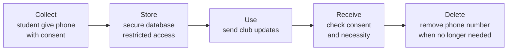

# Data inventory · ITC Club Hub
Version 0.1 · 2026-11-06 · Authors: <CounterBlock>

| Field | Subject | Purpose | Legal basis / consent | Retention | Who can see it | Stored in | Decision |
|-------|---------|---------|-----------------------|-----------|----------------|-----------|----------|
| studentId | student | identify; block double registration | necessary for the service | while account is active,deleted 6 months after graduation | student, admins and authorized administrator | data/students.csv | Mask for organisers: because they don't need the full ID |
| name | student | check-in list at the door | necessary for the service | while the account is active, deleted 6 months after graduation | admin/student/organisers of the event | data/students.csv | keep because it is needed for indentification |
| email | student | necessary for login,reminder by opt-in conset | while the account is active, deleted 6 months after graduation | student/admind/organisers | data/students.csv | keep because it is needed for communication;restrict access and mask in logs and exports |
| phone | student | contact student or SMS reminder | consent (opt-in) | delete at once when consent is withdrawn | student and authorized leader when necessary | data/students.csv | keep only with consent/restrict access |
| attendance | student | record participation | legitimate interest: managing events and checking participation | 1 year after the events, then delete | student/organisers  | data/registrations.csv | keep only for event management |
| dateOfBirth | student | no purpose found | none | Not collected | nobody | not stored | remove because it is unnecessary |

## Copies of personal data
| Copy | Rule |
|------|------|
| log files | only `redacted()` output, never name, email or phone |
| CSV exports | only authorzide administrators can export data. remove unnecessary personal information and delete exports after use |
| test fixtures | Use fake student information instead of real student names, IDs, and phone numbers |
| backups | Encrypte backups, restrict access, and delete old backups according to the retention policy |
| screenshots in docs | hide or blur student names, IDs, emails and phone numbers before sharing screenshots |

## Lifecycle of the phone field

## Client feedback
- TODO